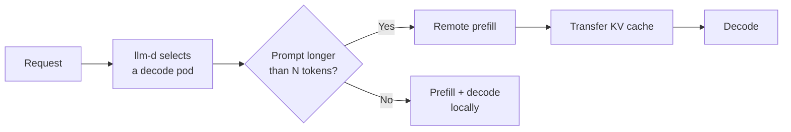
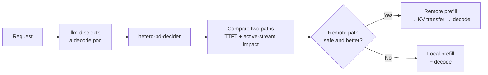
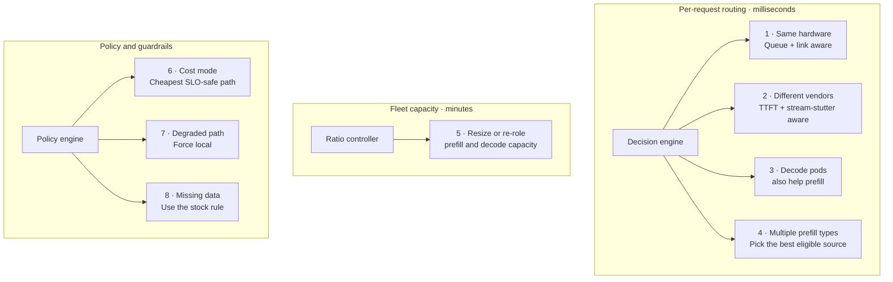
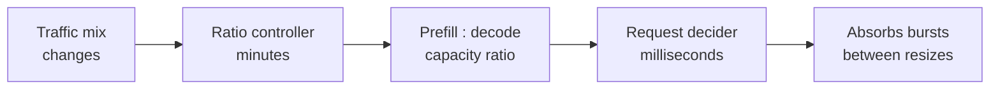
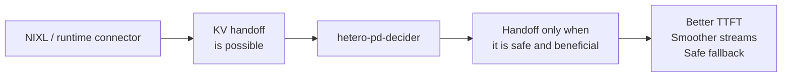

# hetero-pd-decider

**An SLO-aware, hardware-aware decision plugin for heterogeneous prefill/decode disaggregation in [llm-d](https://llm-d.ai).**

`hetero-pd-decider` chooses, for every request, whether to:

- prefill remotely, transfer the KV cache, and decode on the selected decode pod; or
- prefill and decode locally on that decode pod.

It makes that choice from the current queue, accelerator profiles, network cost, KV-cache capacity, model compatibility, the time-to-first-token (TTFT) target, and the disruption that local prefill would cause to users already streaming from the decode pod.

The goal is simple: **use cross-vendor prefill/decode disaggregation only when it improves the service—not merely because a prompt is long.**

> **Illustrative lab:** one NVIDIA A30 prefill pod and two Intel Gaudi 3 decode pods over 25 GbE. Performance values in this README are examples; the lab runbook profiles the real hardware before enabling the policy.

## The problem: a fixed threshold cannot see the system it is routing

llm-d and vLLM already make a KV-cache handoff between compatible runtimes possible—for example through vLLM `NixlConnector` and the Intel Gaudi heterogeneous NIXL path. They solve the **transport** problem.

The stock `prefix-based-pd-decider` solves a narrower **routing** problem: if the uncached prompt is above a fixed number of tokens, split it; otherwise, keep it local. That rule does not know whether the remote prefill pool is queued, the network is slow, the chosen decode pod is idle, or dozens of users are already streaming from it.



<sub>Fixed threshold only: it does not consider queue depth, link health, accelerator type, KV-cache headroom, or active decode streams.</sub>

This is a sensible default when the two pools are identical and lightly loaded. It becomes inefficient when the pool is heterogeneous or traffic is bursty.

## The proposed decision: choose the least harmful path now

After llm-d has selected the decode pod, `hetero-pd-decider` evaluates the two feasible paths for that specific request.



<sub>Safety gate: model identity, KV-cache headroom, link health, measured profiles, SLO, and operator opt-out labels.</sub>

The plugin therefore balances two experiences:

1. **The new user:** how quickly will their first token arrive?
2. **Users already decoding on that pod:** will their token streams stall while that pod prefills a new long prompt?

Prefill/decode disaggregation exists largely to avoid the second problem. A long local prefill can briefly monopolize a decode accelerator and make active token streams stutter. A fixed prompt-length threshold cannot price that cost in.

### The decision model

For each eligible remote prefill path, the plugin estimates:

```text
remote TTFT = remote prefill time + prefill queue time + KV-transfer time
local TTFT  = local prefill time + decode-pod queue time
stall cost  = active decode streams × local prefill time

split only when the remote path is safe, meets the TTFT SLO,
and wins against local TTFT plus the configured active-stream stall cost
```

The actual inputs are measured accelerator profiles and live service signals—not a hard-coded assumption that every long prompt should be split.

## The eight scenarios this design covers

The first four scenarios change **where one request is prefetched**. Scenario 5 changes **how much capacity exists** over minutes. Scenarios 6–8 change the policy or protect correctness. Together, they show why one static prompt-length threshold is not enough.



### Scenario quick reference

| # | Scenario | What the plugin decides | Why it matters | Delivery status |
| ---: | --- | --- | --- | --- |
| 1 | Fixed pools, same hardware | Use remote prefill only when queue and link conditions still make it worthwhile. | Avoids needless remote waits during bursts or network congestion. | Current scope |
| 2 | Fixed pools, A30 prefill + Gaudi decode | Balance remote TTFT against the stall that local prefill would impose on active Gaudi streams. | Protects live conversations while meeting the new user's TTFT SLO. | Current scope |
| 3 | Gaudi pods prefill for each other | Compare the A30, an idle Gaudi, and local prefill as specific sources. | Uses idle Gaudi capacity and avoids a queued A30. | Planned interface evolution |
| 4 | Several prefill pools of different types | Choose the source with the best safe predicted TTFT after queueing and transfer cost. | The fastest accelerator is not always the fastest end-to-end path. | Planned interface evolution |
| 5 | Pool sizes change over time | Resize or re-role prefill and decode capacity from observed traffic mix. | Turns request-level routing into durable fleet cost savings. | Future control-plane capability |
| 6 | Cost mode | When several paths meet the SLO, choose the lower-cost eligible path. | Frees premium decode capacity without reducing user experience. | Future policy mode |
| 7 | Degraded or unsafe path | Reject the handoff and keep the request local. | Prevents incorrect output, KV-cache exhaustion, and latency failures. | Current safety behavior |
| 8 | Missing profiles or metrics | Use llm-d's stock fixed-threshold decision rather than guessing. | Enables incremental rollout with a safe fallback. | Current fallback behavior |

### 1. Fixed pools, same hardware

**Setup:** the prefill and decode pools use the same accelerator type, for example H100s on both sides.

**Stock decision:** send long prompts to the prefill pool; keep short prompts local.

**Plugin decision:** use the same basic split, but also see the prefill queue and link health. If the prefill pool is backed up or the link is congested, keep an otherwise eligible request local.

**Value: small but useful.** The stock threshold is broadly reasonable here; the improvement appears under bursty traffic or a constrained network.

### 2. Fixed pools, different vendors — the A30/Gaudi lab

**Setup:** one NVIDIA A30 is the prefill pool; two Intel Gaudi 3 pods are the decode pool.

For a 2,000-token prompt, assume an A30 prefill rate of about 5,000 tokens/s, a Gaudi 3 prefill rate of about 20,000 tokens/s, a 25 GbE link, and a 1-second TTFT target. These figures are illustrative.

| Path | Estimated TTFT | Effect on users already generating on the Gaudi |
| --- | ---: | --- |
| Remote: A30 prefill → KV transfer → Gaudi decode | about 0.5 s | None |
| Local: Gaudi prefill + decode | about 0.1 s | Every active stream can pause for about 0.1 s |

| Situation | Stock fixed-threshold decider | `hetero-pd-decider` | Why it matters |
| --- | --- | --- | --- |
| Long prompt; Gaudi is serving 40 active streams | Remote | Remote | The new user stays within the SLO and 40 active conversations do not stutter. |
| Long prompt; Gaudi is idle | Remote, about 0.5 s TTFT | Local, about 0.1 s TTFT | Nobody is disturbed, so the transfer is unnecessary. |
| Ten long prompts arrive together | All queue behind the A30 | Use remote while it can meet the SLO; send overflow local | A single prefill card does not turn a burst into multi-second waits. |
| Short or mostly cached prompt | Local | Local | The transfer overhead is not worthwhile. |

**Value: medium to high.** This is the core lab scenario: the fixed threshold cannot see that an A30 and a Gaudi behave differently or that active decode streams deserve protection.

### 3. Gaudi pods can prefill for each other

**Setup:** the A30 remains available, but Gaudi pods are also eligible prefill sources.

**Example:** Gaudi-1 is decoding for 50 users, Gaudi-2 has 5 users, and the A30 has six requests queued. The best choice may be Gaudi-2 prefill → KV transfer → Gaudi-1 decode: it avoids interrupting Gaudi-1 while bypassing the A30 queue.

**What is new:** the plugin must compare specific prefill pods, not merely “the prefill pool” versus “local.” This is a planned interface evolution, not a claim that the current v1 interface already selects arbitrary source pods.

**Value: high.** It turns idle capacity in the decode fleet into a useful, fast prefill option.

### 4. Several prefill pools of different types

**Setup:** an A30 prefill pool and a B200 prefill pool both feed Gaudi decode pods.

**Example:** the B200 is much faster but already has eight requests queued; the A30 is idle. For a 1,500-token prompt, the plugin compares waiting for B200 against starting on A30 immediately and selects the path with the best safe predicted TTFT.

**What is new:** like scenario 3, this needs specific-pod or specific-pool comparison in the llm-d interface.

**Value: high.** “Fastest accelerator” is not necessarily the fastest path once queueing is included.

### 5. Pool sizes change over time

**Setup:** a ratio controller complements the per-request plugin.



During the day, chat traffic can be decode-heavy; the controller adds Gaudi decode capacity. At night, a long-prompt summarization workload can justify more inexpensive prefill capacity. In a fixed lab, it cannot add hardware, but it can recommend the right purchase ratio or re-role eligible Gaudi pods.

**Value: highest long-term cost impact.** The per-request plugin protects the service now; the controller right-sizes the fleet later.

### 6. Cost mode

**Setup:** the TTFT SLO has slack—for example, 2 seconds when both feasible paths complete in less than 1 second.

**Plugin decision:** when more than one path meets the SLO and safety checks, prefer the lower-cost path. An A30 prefill can free more expensive Gaudi capacity for decode, reducing the number of Gaudi pods required for the same user load.

**Value: medium.** Cost mode is a tie-breaker; scenario 5 is what turns it into sustained infrastructure savings.

### 7. A path is degraded or unsafe

**Setup:** the plugin detects any of the following:

- the network is slow or a KV transfer fails;
- the target Gaudi KV cache is nearly full;
- prefill and decode pods run different approved model builds or tokenizers; or
- a cross-vendor correctness/drift canary fails.

**Plugin decision:** do not attempt the split. Keep the request local on one approved runtime.

**Value: safety.** Cross-vendor serving must not quietly produce incorrect output or violate latency targets.

### 8. Required data is missing

**Setup:** a new accelerator class has joined the cluster but has not been profiled, or the metrics service is unavailable.

**Plugin decision:** do not invent an estimate. Fall back to llm-d's fixed prompt-length threshold rule.

**Value: safe adoption.** The plugin can be introduced incrementally: in the worst case, it behaves like the stock decider.

## What this adds to the existing stack



The plugin is deliberately **not** a replacement for llm-d, vLLM, NIXL, or accelerator vendors' runtime plugins. It is the decision layer between **“a KV handoff is technically possible”** and **“this handoff is the best safe choice for this request right now.”**

See [docs/design.md](docs/design.md) for the detailed decision model and implementation contracts.

## Repository layout

| Path | Contents |
| --- | --- |
| [`plugin/llm-d-patch/`](plugin/llm-d-patch) | Patch for [llm-d-inference-scheduler](https://github.com/llm-d/llm-d-inference-scheduler) at the commit in `BASE_COMMIT` |
| [`plugin/src/`](plugin/src) | Readable copies of the plugin sources from the patch, plus a sample EPP config |
| [`plugin/src/hetero/`](plugin/src/hetero) | Decision core, standard library only, with its own `go.mod` for standalone tests |
| [`lab/`](lab) | Runbook, Helm values, Kustomize layouts and scripts for one NVIDIA A30 and two Intel Gaudi 3 on OpenShift |
| [`tools/xvkv/`](tools/xvkv) | Earlier cross-vendor KV handoff prototype; its drift harness checks cross-vendor output correctness |
| [`docs/`](docs) | Design notes |

## Quick start

Test the decision core (Go 1.22 or newer):

```bash
cd plugin/src/hetero && go test -v ./...
```

Build an llm-d EPP image with the plugin:

```bash
git clone https://github.com/llm-d/llm-d-inference-scheduler.git && cd llm-d-inference-scheduler
git checkout -b hetero-pd-decider $(cat ../plugin/llm-d-patch/BASE_COMMIT)
git apply ../plugin/llm-d-patch/hetero-pd-decider.patch
make test-filter PATTERN='HeteroPD|TestDecide|TestConfigValidate' TYPE=epp
make image-build-epp EPP_IMAGE=quay.io/<you>/llm-d-router-endpoint-picker:hetero-pd-dev
```

Configure it in the EPP plugin config:

```yaml
- type: disagg-profile-handler
  parameters:
    deciders:
      prefill: hetero-pd-decider
- type: hetero-pd-decider
  parameters:
    ttftSLOMs: 1000
    bandwidthGbps: 25
    profiles:
      nvidia-a30:   {prefillTokensPerSec: 5000}
      intel-gaudi3: {prefillTokensPerSec: 20000}
```

Then follow [lab/README.md](lab/README.md) to deploy, check correctness, profile the hardware and run the A/B test against the stock decider.

## Status

| Component | State |
| --- | --- |
| Decision core (`plugin/src/hetero`) | Compiled and tested; 98% statement coverage |
| llm-d adapter (`hetero_pd_decider.go`) and its tests | Written against llm-d-inference-scheduler at `BASE_COMMIT`; first compile happens in lab step 1 |
| Lab manifests and scripts | Kustomize layouts build; scripts tested against a mock OpenAI streaming server |
| Hardware results | Pending |

Plugin stability: Alpha.

## Related upstream work

- [vLLM NixlConnector roadmap](https://github.com/vllm-project/vllm/issues/33702) and [heterogeneous block size RFC](https://github.com/vllm-project/vllm/issues/26744)
- [vllm-gaudi heterogeneous NIXL connector](https://docs.vllm.ai/projects/gaudi/en/0.24.0/api/vllm_gaudi/distributed/kv_transfer/kv_connector/v1/hetero_hpu_nixl_connector.html)
- [llm-d disaggregated serving](https://llm-d.ai/docs/architecture/advanced/disaggregation) and [latency predictor](https://llm-d.ai/docs/dev/architecture/router/latency-predictor)
- [llm-d three-vendor heterogeneous serving](https://llm-d.ai/blog/heterogeneous-inference-3-vendor-sovereign-cluster)

## License

Apache License 2.0. The plugin is written as a contribution to llm-d, which is Apache 2.0.
