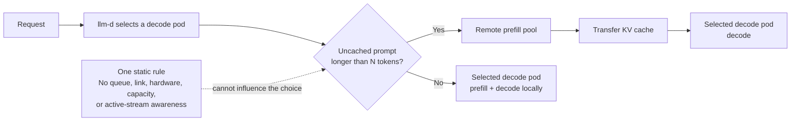
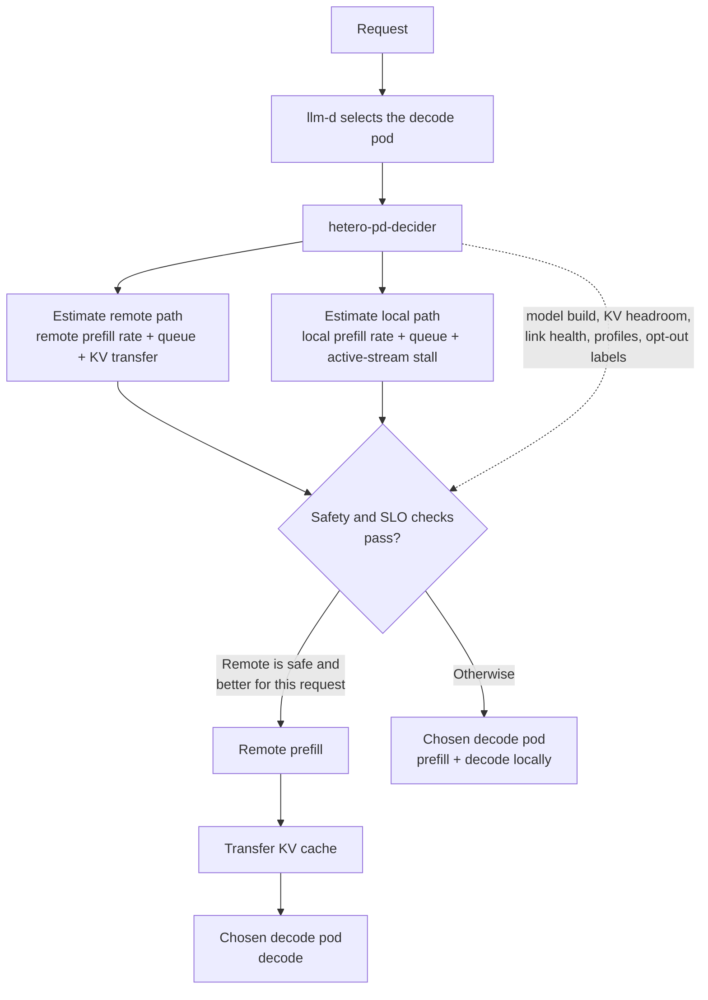
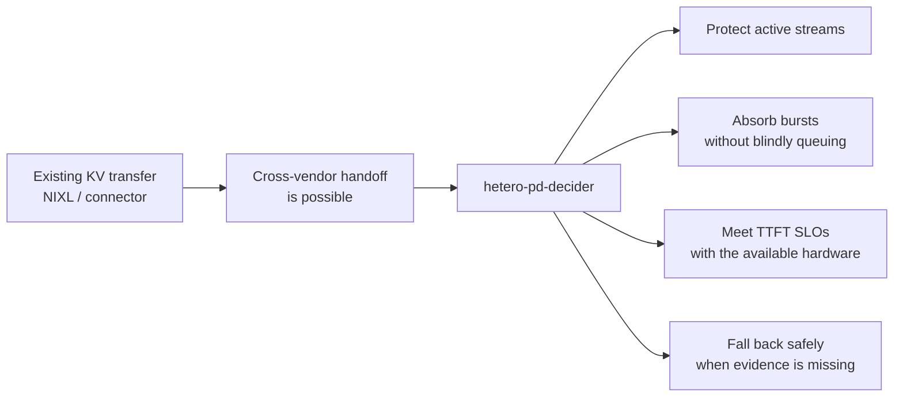

# hetero-pd-decider

**An SLO-aware, hardware-aware decision plugin for heterogeneous prefill/decode disaggregation in [llm-d](https://llm-d.ai).**

`hetero-pd-decider` chooses, for every request, whether to:

- prefill remotely, transfer the KV cache, and decode on the selected decode pod; or
- prefill and decode locally on that decode pod.

It makes that choice from the current queue, accelerator profiles, network cost, KV-cache capacity, model compatibility, the time-to-first-token (TTFT) target, and the disruption that local prefill would cause to users already streaming from the decode pod.

The goal is simple: **use cross-vendor prefill/decode disaggregation only when it improves the service—not merely because a prompt is long.**

> **Illustrative lab:** one NVIDIA A30 prefill pod and two Intel Gaudi 3 decode pods over 25 GbE. Performance values in this README are examples; the lab runbook profiles the real hardware before enabling the policy.

## The problem: a fixed threshold cannot see the system it is routing

llm-d and vLLM already make a KV-cache handoff between compatible runtimes possible—for example through vLLM `NixlConnector` and the Intel Gaudi heterogeneous NIXL path. They solve the **transport** problem.

The stock `prefix-based-pd-decider` solves a narrower **routing** problem: if the uncached prompt is above a fixed number of tokens, split it; otherwise, keep it local. That rule does not know whether the remote prefill pool is queued, the network is slow, the chosen decode pod is idle, or dozens of users are already streaming from it.



This is a sensible default when the two pools are identical and lightly loaded. It becomes inefficient when the pool is heterogeneous or traffic is bursty.

## The proposed decision: choose the least harmful path now

After llm-d has selected the decode pod, `hetero-pd-decider` evaluates the two feasible paths for that specific request.



The plugin therefore balances two experiences:

1. **The new user:** how quickly will their first token arrive?
2. **Users already decoding on that pod:** will their token streams stall while that pod prefills a new long prompt?

Prefill/decode disaggregation exists largely to avoid the second problem. A long local prefill can briefly monopolize a decode accelerator and make active token streams stutter. A fixed prompt-length threshold cannot price that cost in.

### The decision model

For each eligible remote prefill path, the plugin estimates:

```text
remote TTFT = remote prefill time + prefill queue time + KV-transfer time
local TTFT  = local prefill time + decode-pod queue time
stall cost  = active decode streams × local prefill time

split only when the remote path is safe, meets the TTFT SLO,
and wins against local TTFT plus the configured active-stream stall cost
```

The actual inputs are measured accelerator profiles and live service signals—not a hard-coded assumption that every long prompt should be split.

## A concrete story: A30 prefill + Gaudi 3 decode

For a 2,000-token prompt, assume an A30 prefill rate of about 5,000 tokens/s, a Gaudi 3 prefill rate of about 20,000 tokens/s, a 25 GbE link, and a 1-second TTFT target. These figures are illustrative.

| Path | Estimated TTFT | Effect on users already generating on the Gaudi |
| --- | ---: | --- |
| Remote: A30 prefill → KV transfer → Gaudi decode | about 0.5 s | None |
| Local: Gaudi prefill + decode | about 0.1 s | Every active stream can pause for about 0.1 s |

Neither path is always right. The plugin chooses based on the state of the selected Gaudi and the shared A30 pool at that moment.

| Situation | Stock fixed-threshold decider | `hetero-pd-decider` | Why it matters |
| --- | --- | --- | --- |
| Long prompt; Gaudi is serving 40 active streams | Remote | Remote | Meets the new user's SLO without interrupting 40 ongoing conversations. |
| Long prompt; Gaudi is idle | Remote, about 0.5 s TTFT | Local, about 0.1 s TTFT | There is nobody to protect, so avoid an unnecessary transfer. |
| Ten long prompts arrive together | All queue behind the A30 | Use remote while it can meet the SLO; send overflow local | Prevents a single inexpensive prefill card from turning a burst into multi-second waits. |
| Short or mostly cached prompt | Local | Local | The transfer overhead is not worthwhile. |
| Slow link, low KV headroom, model mismatch, or transfer failure | May still split if the prompt is long | Local | Correctness and safe capacity override the routing preference. |

## What value does this add?



- **Better user experience:** protect live decoding streams from avoidable prefill stalls while keeping new-request TTFT inside its target.
- **Higher useful capacity:** use a lower-cost prefill accelerator when it helps, but do not queue every long request behind it during bursts.
- **Real heterogeneous routing:** make a decision from each accelerator's measured performance rather than treating an A30 and a Gaudi as interchangeable.
- **Safe adoption:** reject unsafe handoffs due to model-build mismatch, inadequate KV-cache headroom, link degradation, or failed correctness checks.
- **No-data fallback:** when a new accelerator lacks a profile or metrics are unavailable, revert to llm-d's familiar fixed-threshold behavior instead of guessing.

## Scope and roadmap

| Capability | What it does | Status |
| --- | --- | --- |
| Per-request adaptive routing | Compare remote prefill with local prefill after llm-d chooses the decode pod | Current plugin scope |
| Cross-vendor safety gates | Check model identity, KV headroom, link/SLO eligibility, and opt-out labels before a handoff | Current plugin scope |
| Specific-pod comparison | Choose among an A30, an idle Gaudi, or another eligible prefill pod for a particular decode pod | Planned interface evolution |
| Role-flexible Gaudi pods | Let Gaudi pods assist with prefill as well as decode when cluster load changes | Planned interface evolution |
| Ratio controller | Resize or re-role prefill and decode capacity over minutes; the plugin handles requests in milliseconds between changes | Future control-plane capability |
| Cost mode | Prefer the lower-cost eligible path when both meet the SLO | Future policy mode |

The plugin is deliberately **not** a replacement for llm-d, vLLM, NIXL, or accelerator vendors' runtime plugins. It is the decision layer between “a KV handoff is technically possible” and “this handoff is the best safe choice for this request right now.”

## Safety behavior

The decider keeps the request local when any required evidence is absent or unsafe:

- remote transfer would miss the TTFT SLO or the link is degraded;
- the decode pod has insufficient KV-cache headroom;
- prefill and decode pods do not serve the same approved model build or tokenizer;
- a correctness/drift canary rejects the cross-vendor path;
- an operator opts a pod out with a label; or
- the selected accelerator class has not yet been profiled.

The last condition is important: **unknown is not treated as fast.** The safe fallback is the stock fixed-threshold behavior.

See [docs/design.md](docs/design.md) for the detailed decision model, contracts, and scenarios.

## Repository layout

| Path | Contents |
| --- | --- |
| [`plugin/llm-d-patch/`](plugin/llm-d-patch) | Patch for [llm-d-inference-scheduler](https://github.com/llm-d/llm-d-inference-scheduler) at the commit in `BASE_COMMIT` |
| [`plugin/src/`](plugin/src) | Readable copies of the plugin sources from the patch, plus a sample EPP config |
| [`plugin/src/hetero/`](plugin/src/hetero) | Decision core, standard library only, with its own `go.mod` for standalone tests |
| [`lab/`](lab) | Runbook, Helm values, Kustomize layouts and scripts for one NVIDIA A30 and two Intel Gaudi 3 on OpenShift |
| [`tools/xvkv/`](tools/xvkv) | Earlier cross-vendor KV handoff prototype; its drift harness checks cross-vendor output correctness |
| [`docs/`](docs) | Design notes |

## Quick start

Test the decision core (Go 1.22 or newer):

```bash
cd plugin/src/hetero && go test -v ./...
```

Build an llm-d EPP image with the plugin:

```bash
git clone https://github.com/llm-d/llm-d-inference-scheduler.git && cd llm-d-inference-scheduler
git checkout -b hetero-pd-decider $(cat ../plugin/llm-d-patch/BASE_COMMIT)
git apply ../plugin/llm-d-patch/hetero-pd-decider.patch
make test-filter PATTERN='HeteroPD|TestDecide|TestConfigValidate' TYPE=epp
make image-build-epp EPP_IMAGE=quay.io/<you>/llm-d-router-endpoint-picker:hetero-pd-dev
```

Configure it in the EPP plugin config:

```yaml
- type: disagg-profile-handler
  parameters:
    deciders:
      prefill: hetero-pd-decider
- type: hetero-pd-decider
  parameters:
    ttftSLOMs: 1000
    bandwidthGbps: 25
    profiles:
      nvidia-a30:   {prefillTokensPerSec: 5000}
      intel-gaudi3: {prefillTokensPerSec: 20000}
```

Then follow [lab/README.md](lab/README.md) to deploy, check correctness, profile the hardware and run the A/B test against the stock decider.

## Status

| Component | State |
| --- | --- |
| Decision core (`plugin/src/hetero`) | Compiled and tested; 98% statement coverage |
| llm-d adapter (`hetero_pd_decider.go`) and its tests | Written against llm-d-inference-scheduler at `BASE_COMMIT`; first compile happens in lab step 1 |
| Lab manifests and scripts | Kustomize layouts build; scripts tested against a mock OpenAI streaming server |
| Hardware results | Pending |

Plugin stability: Alpha.

## Related upstream work

- [vLLM NixlConnector roadmap](https://github.com/vllm-project/vllm/issues/33702) and [heterogeneous block size RFC](https://github.com/vllm-project/vllm/issues/26744)
- [vllm-gaudi heterogeneous NIXL connector](https://docs.vllm.ai/projects/gaudi/en/0.24.0/api/vllm_gaudi/distributed/kv_transfer/kv_connector/v1/hetero_hpu_nixl_connector.html)
- [llm-d disaggregated serving](https://llm-d.ai/docs/architecture/advanced/disaggregation) and [latency predictor](https://llm-d.ai/docs/dev/architecture/router/latency-predictor)
- [llm-d three-vendor heterogeneous serving](https://llm-d.ai/blog/heterogeneous-inference-3-vendor-sovereign-cluster)

## License

Apache License 2.0. The plugin is written as a contribution to llm-d, which is Apache 2.0.
