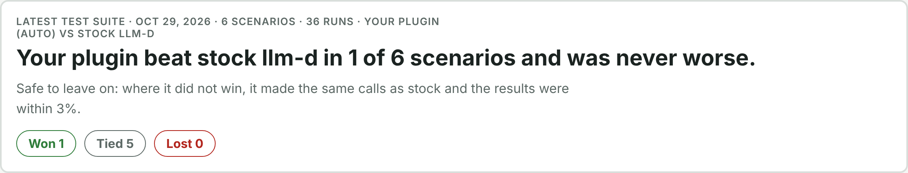
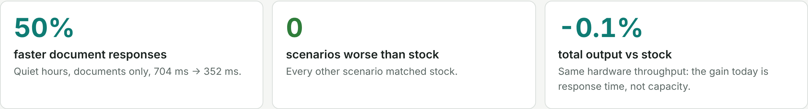
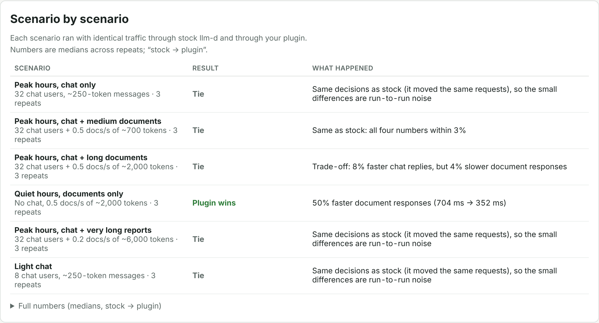
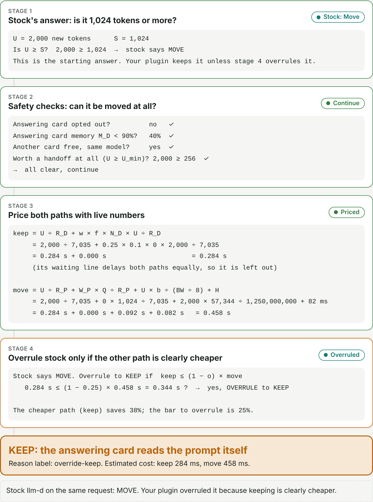

# hetero-pd-decider

**A hardware-aware prefill/decode decider for [llm-d](https://llm-d.ai). For each request, it decides whether handing the prompt to another card, possibly from another vendor, is worth the KV transfer.**

In llm-d's prefill/decode (P/D) disaggregation, a request can be split: one card reads the prompt (prefill), then hands the KV cache over [NIXL](https://github.com/ai-dynamo/nixl) to the card that writes the answer (decode). The alternative is that the decode card does both. `hetero-pd-decider` makes that choice per request, using how fast each card is, how busy it is, and what the handoff costs. It starts from llm-d's own answer and changes it only when the other path is clearly faster, and it never pairs two cards that cannot exchange KV.

## The gap in llm-d today

The only conditional rule in llm-d is a fixed threshold on the part of the prompt the decode card has not cached:

> "Disaggregate prefill when `(inputTokens - hitPrefixTokens) >= nonCachedTokens`. `nonCachedTokens = 0` disables it." ([llm-d-router docs](https://github.com/llm-d/llm-d-router/blob/main/docs/coordinator_architecture.md))

| What llm-d does today | Source |
| --- | --- |
| Default `nonCachedTokens: 0`, which means never split. The doc examples use 8, which splits almost every request. | [docs/disaggregation.md](https://github.com/llm-d/llm-d-router/blob/main/docs/disaggregation.md) |
| The official P/D guide uses `always-disagg-pd-decider`: every request is split. | [P/D guide](https://llm-d.ai/docs/well-lit-paths/foundations/pd-disaggregation) |
| The predicted-latency router should be skipped for mixed pools: it "assumes a homogeneous pool". | [Predicted latency](https://llm-d.ai/docs/well-lit-paths/foundations/predicted-latency) |
| KV transfer cost is not a decision input, even though NIXL over TCP is called "extremely slow". | [P/D architecture](https://llm-d.ai/docs/architecture/disaggregation/pd-disaggregation) |

So one fixed number decides every request, whatever the cards, their queues, or the link between them. When an NVIDIA card and an Intel Gaudi share a pool, a long prompt can be sent to a slower or busier card, or over a slow link, and arrive later than if it had stayed put.

## How it decides (`strategy: auto`, the default)

| Step | What happens |
| --- | --- |
| 1. Stock answer first | Apply llm-d's rule: split if the uncached prompt is at least `stockNonCachedTokens` (1,024). |
| 2. Safety checks | Keep the request local if the prompt is short (< 256 tokens), there is no prefill pod that can exchange KV with the decode card (see below), the decode card's KV cache is ≥ 90% full, or decode is disabled. If any card class has no speed profile, use the stock answer. |
| 3. Price both paths | **keep** = local prefill time + the stall it causes for answers already streaming on that card.<br>**move** = remote prefill time + the remote card's queue + KV transfer time + fixed handoff time. |
| 4. Overrule only when clearly better | Change stock's answer only if the other path is at least 25% cheaper (`overrideMargin`), and for a move, only if it also meets the TTFT target. |

**Examples** (A30 reads prompts, Gaudi 3 writes answers, stock threshold 1,024 tokens):

| Situation | Stock | Plugin | Why |
| --- | --- | --- | --- |
| Long new document, Gaudi idle | split | **keep** | The Gaudi reads it faster itself, with no handoff. |
| Long new document, Gaudi busy with many streams | split | split | Moving protects the answers already streaming. |
| Long document, A30 queue backed up | split | **keep** | Waiting in the A30 queue costs more than it saves. |
| Chat turn, mostly cached | keep | keep | Little new text, so the handoff isn't worth it. |
| Short prompt | keep | keep | Below 256 tokens it always stays local. |
| Gaudi KV cache 95% full | split | **keep** | Safety: the KV lands on the Gaudi either way, so a transfer adds cost and risk without freeing memory. |

Each decision is counted in `llm_d_epp_hetero_pd_decision_total{reason}`, where `reason` is `stock-split`, `stock-keep`, `override-keep`, `override-move`, `short-prompt`, `decode-kv-full`, `decode-disabled`, `no-prefill-candidate`, or `no-compatible-prefill`.

## Only pairs that can exchange KV

Two cards can hand KV to each other only when they match in everything vLLM checks during the NIXL handshake: model path, vLLM build, attention backend, KV layout, block size, KV dtype and parallelism. If they don't, the decode card rejects every handoff and the request fails. Two NVIDIA generations can already differ here, because each picks its own attention backend by default.

| Part | What it does |
| --- | --- |
| **Compatibility key** | A labeler ([`lab/compat/`](lab/compat)) gives every model-server pod `llm-d.ai/kv-compat-key`, a hash of those settings. Same key: allowed. Different keys: blocked. A missing key in a mixed pool: blocked. |
| **Prefill filter** | `hetero-kv-compat-filter` in the `prefill` scheduling profile drops prefill pods that can't take KV from the chosen decode pod, so an incompatible pair is never scheduled. The decider applies the same rule. |
| **Failed handoffs** | 3 failed handoffs in a row exclude that pair for 10 minutes (`hetero_pd_pair_exclusions_total`). A failure is never treated as a cost. |
| **Test, then approve** | For pairs with different keys, the labeler runs a validation Job by itself: cold, greedy requests on the decode card alone and split, comparing answers. A person approves a passed pair on the lab dashboard or with `62-approve-pair.sh`, and the router picks it up within about 30 seconds with no restart. A key change revokes the approval and tests again. |
| **Speed per pod** | When a pod's key changes, the labeler measures its prefill speed once and labels it `llm-d.ai/prefill-tokens-per-sec`. The plugin uses that number in place of the class profile. |

## Results so far

### NVIDIA mixed generations on AWS (T4 + A10G + L4), Nov 2, 2026

**Lab:** OpenShift 4.22 on AWS. T4 and A10G read prompts, L4 writes answers. Qwen2.5-1.5B-Instruct, vLLM 0.26.0, NIXL. llm-d's default routing (`prefix-based-pd-decider`, 1,024 tokens) against the plugin, 3 runs each. Raw data and logs: [`evidence/aws-2026-11-02/`](evidence/aws-2026-11-02).

**Test 1: cards with different settings.** By default the T4 uses a different attention backend, so the L4 rejects its handoffs (`NIXL compatibility hash mismatch`). The validation Job found the same: 20 of 20 split requests rejected.

| What we measured | llm-d default | With the plugin |
| --- | --- | --- |
| Long documents that failed, busy system | about 40 of 86 | **0 of 86** |
| Long documents that failed, idle system | about 73 of 86 | **0 of 86** |
| Chat messages that failed | 0 | 0 |

**Test 2: all cards with the same settings** (`--attention-backend TRITON_ATTN`), so every pair can exchange KV. Measured prefill speed: A10G 15.3k, L4 13.2k, T4 2.2k tokens/s.

| What we measured | llm-d default | With the plugin |
| --- | --- | --- |
| Requests that failed | 0 | 0 |
| Wait for a long document's answer to start, idle system | 0.20 s | **0.04 s** |
| Wait for a very long report's answer to start, busy system | 0.85 s | **0.61 s** |
| Wait for a long document's answer to start, busy system | 0.29 s | 0.31 s (same) |
| Chat speed | same | same |

When the cards don't match, the default routing loses most long requests and the plugin loses none. When they do match, the plugin is never slower, and it's faster when it avoids an unneeded handoff or the slow T4.

### Two NVIDIA A30s

**Lab:** OpenShift 4.22, 2 × NVIDIA A30, Qwen2.5-7B-Instruct, vLLM 0.26.0, NIXL over TCP. Compared against stock at `nonCachedTokens: 1024`, over 3 test suites × 6 scenarios (9 repeats).

| Scenario | Result |
| --- | --- |
| Quiet hours, documents only (~2,000 tokens) | **First-token time 704 ms → 352 ms (−50%)** |
| The other 5 scenarios (peak chat; peak chat + medium, long or very long documents; light chat) | **Tie**: same decisions or results within a few percent, so no regression where stock was already right |

### Lab dashboard results

The suite verdict from the lab dashboard's Value tab (latest suite, Oct 29, 2026, 36 runs, auto vs stock):







How the plugin reached the winning decision for an idle 2,000-token document (dashboard "How it decides" tab). Stock says move; the plugin keeps it because keeping costs 284 ms against 458 ms for moving:



NIXL handoff took 2–5 ms when idle. Under load, 71% of 27,769 transfers took 0.1–0.75 s over TCP. That's why transfer cost belongs in the decision.

**Mixed vendor (A30 + Intel Gaudi 3):** the plugin builds, deploys and makes cross-vendor decisions (smoke test: `override-keep` with the Gaudi as the decode card). No KV has moved between the two vendors yet: the Gaudi server went down for a cooling fix first. With the compatibility check, that pair stays blocked until it passes a validation run and is approved.

## Quick start

Test the decision core (Go 1.22+):

```bash
cd plugin/src/hetero && go test -v ./...
```

Build an llm-d router image with the plugin. The patch applies to the commit in `BASE_COMMIT`, to `v1.0.0`, and to current `main`.

```bash
git clone https://github.com/llm-d/llm-d-router.git && cd llm-d-router
git checkout -b hetero-pd-decider $(cat ../plugin/llm-d-patch/BASE_COMMIT)
git apply ../plugin/llm-d-patch/hetero-pd-decider.patch
make image-build-epp EPP_IMAGE=quay.io/<you>/llm-d-router-endpoint-picker:hetero-pd-dev
```

Configure it (Alpha plugin, so start the router with `--allow-experimental-plugins=true`). Pods need the labels `llm-d.ai/role` and `llm-d.ai/accelerator-class`, plus `llm-d.ai/kv-compat-key` in a mixed pool (the labeler in [`lab/compat/`](lab/compat) sets it). Add `hetero-kv-compat-filter` to the `prefill` scheduling profile.

```yaml
- type: hetero-kv-compat-filter
- type: disagg-profile-handler
  parameters:
    deciders:
      prefill: hetero-pd-decider
- type: hetero-pd-decider
  parameters:
    strategy: auto              # auto | model | guarded-stock
    stockNonCachedTokens: 1024  # stock's threshold, used as the starting answer
    overrideMargin: 0.25        # overrule stock only when the other path is 25% cheaper
    ttftSLOMs: 1000
    bandwidthGbps: 10
    handoffOverheadMs: 82       # measure on your cluster
    compatibility: auto         # different llm-d.ai/kv-compat-key: never paired unless approved
    failureThreshold: 3         # failed handoffs in a row that exclude a pair...
    exclusionSeconds: 600       # ...for this long
    kvBytesPerToken: 57344      # Qwen2.5-7B, bf16
    profiles:
      nvidia-a30:   {prefillTokensPerSec: 7035}   # measured
      intel-gaudi3: {prefillTokensPerSec: 20000}  # placeholder until measured
```

The full sample is in [plugin/src/hetero-pd-epp-config.yaml](plugin/src/hetero-pd-epp-config.yaml).

## Repository layout

| Path | Contents |
| --- | --- |
| [`plugin/llm-d-patch/`](plugin/llm-d-patch) | The patch for llm-d-router, and the commit it was built on |
| [`plugin/src/`](plugin/src) | Readable plugin sources, tests (100% coverage of the decision core) and a sample config |
| [`lab/a30-only/`](lab/a30-only) | Scripted rebuild of the A30 lab on any OpenShift cluster with two A30s |
| [`lab/mixed/`](lab/mixed) | A30 + Gaudi 3 build and deploy, the in-cluster Gaudi thermal watchdog, and the thermal test |
| [`lab/compat/`](lab/compat) | The compatibility labeler (keys, automatic pair tests, approvals, per-pod speed), the validation Job and the approval script |
| [`lab/aws-nvidia/`](lab/aws-nvidia) | The T4 + A10G + L4 lab on OpenShift on AWS: one-command install, test plan, status and evidence scripts |
| [`evidence/`](evidence) | Raw results and logs behind the AWS numbers above |
| [`lab/dashboard2/`](lab/dashboard2) | Lab dashboard: decision walkthrough, router mode switch, traffic and test suites, value summary, live stack and card-compatibility panel |
| [`lab/hwmon/`](lab/hwmon) | Live hardware panel (fans, temperatures, power and network cards from the BMC and drivers) and a heat test |
| [`lab/scripts/`](lab/scripts) | Step-by-step lab scripts: operators, builds, calibration, correctness, health checks, export |
| [`lab-archive/*/results/`](lab-archive) | Raw suite results and run history behind the numbers above |
| [`docs/`](docs) | Design notes and the upstream feature request |
| [`tools/xvkv/`](tools/xvkv) | Earlier cross-vendor KV handoff prototype and its output-drift checks |

## Roadmap

- **Mixed-vendor test suites** (A30 + Gaudi 3) through vllm-gaudi's cross-device NIXL connector, once the Gaudi server's cooling is fixed: tested and approved through the compatibility flow.
- **Use vLLM's own compatibility hash** as the key, if vLLM publishes it ([vllm#59111](https://github.com/vllm-project/vllm/issues/59111)), instead of recomputing it.
- **Cards with a bigger speed gap** and more than one decode server, where speed-aware choice should matter more.
- **Choose between specific prefill pods**, for example an idle Gaudi preparing a prompt for a busy one, instead of only "remote pool or local".
- **Cost mode:** when several paths meet the target, prefer the cheaper hardware.

See [docs/design.md](docs/design.md) for the original design and the longer list of scenarios.

## Related work

- [llm-d P/D disaggregation](https://llm-d.ai/docs/architecture/disaggregation/pd-disaggregation) and [predicted-latency routing](https://llm-d.ai/docs/well-lit-paths/foundations/predicted-latency)
- [vllm-gaudi heterogeneous NIXL connector](https://docs.vllm.ai/projects/gaudi/en/0.24.0/api/vllm_gaudi/distributed/kv_transfer/kv_connector/v1/hetero_hpu_nixl_connector.html)
- [llm-d three-vendor heterogeneous serving](https://llm-d.ai/blog/heterogeneous-inference-3-vendor-sovereign-cluster)

## License

Apache License 2.0, the same as llm-d.
